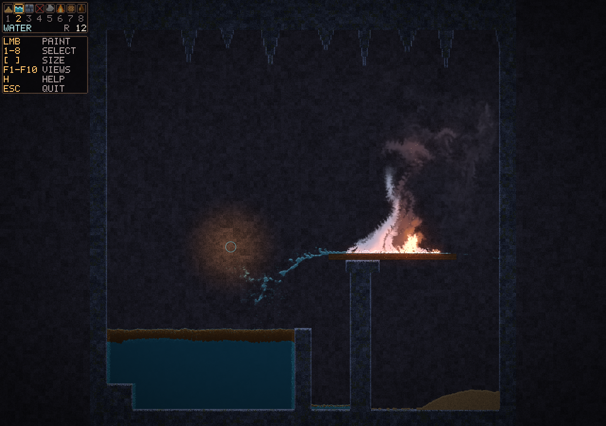

# Powder Game

[](https://github.com/FueledByRedBull/Powder-Game/actions/workflows/ci.yml)
[](https://github.com/FueledByRedBull/Powder-Game/actions/workflows/release.yml)

A falling-sand sandbox that runs entirely on the GPU. Paint sand, water, rock, smoke, fire, wood and oil onto a 1000 x 1000 grid: sand piles up, water pours and pools, oil floats and burns, and fire spreads through wood until something puts it out.



*An interactive frame (1280x900, lantern and HUD) of the scripted `showcase` scene: `powder_app_lifecycle_tests showcase` with `POWDER_FRAME_DIR` set.*

Sand is an MPM-style particle solid, water and oil are an APIC/FLIP liquid, and smoke, fire, steam and heat run on a half-resolution gas grid. One cell is 5 mm, so the grid is a 5 m cave with real gravity: a full-height drop takes about a second. Water quenches fire, and sand and solids block gas. Every pass is an OpenGL 4.3 compute shader; during play the CPU schedules passes and reads back only small convergence results. Written in C++20 for Windows 11 and Linux, with GLFW and GLAD.

## Quick start

You need a GPU and driver with OpenGL 4.3 core and enough shader resources: at least 18 image units and compute image uniforms, 19 combined shader output resources and 8 SSBO binding points. The app checks these at startup. The scene shader also uses 16 fragment texture units, the OpenGL 4.3 minimum. Building needs CMake 3.24 or newer, a C++20 compiler and Python (for the GLAD generator). CMake fetches pinned copies of GLFW and GLAD when no system copies are found.

### Windows 11

From a Visual Studio 2022 Developer PowerShell with CMake and Python on the path:

```powershell
$env:PYTHONUTF8 = '1'
cmake -S . -B build-msvc -A x64
cmake --build build-msvc --config Release --parallel
.\build-msvc\Release\powder_game.exe
```

`powder_game.exe` is self-contained: the shaders are compiled into it and the C/C++ runtime is linked statically (`/MT`), so the executable alone runs from any folder without the VC++ redistributable. To try shader edits without rebuilding, set `POWDER_SHADER_DIR` to a folder holding every shader (for example the repository's `shaders`); the app then loads all of them from there and fails, naming the file, if one is missing. A `shaders` folder beside the executable is ignored. `PYTHONUTF8` stops the pinned GLAD generator misreading its bundled OpenGL specification under non-UTF-8 Windows locales.

### Linux

```bash
cmake -S . -B build -DCMAKE_BUILD_TYPE=Release
cmake --build build -j
./build/powder_game
```

On Ubuntu the CI job installs `build-essential`, `cmake`, `pkg-config`, `python3` and the X11, Wayland and Mesa development packages listed in [`.github/workflows/ci.yml`](.github/workflows/ci.yml).

### Windows package from Linux

`./build-win11.sh` cross-compiles with MinGW and writes `dist/win11/PowderGame-win11-x64.zip`. It needs `x86_64-w64-mingw32-gcc`/`g++` and `zip`. This path has not been run in the project's Windows validation environment.

## Controls

The world is dark: a dim moonlit cave, with fire and hot gas as the light that matters. A compact inventory sits top-left, a row of eight pixel-art slots with their key numbers, the selected material's name and the brush radius, and under it a small help panel that hides itself after a few seconds. The window opens at 85% of the screen height, sized so all of it fits in the left letterbox margin and never covers the play area; where the margin is narrower it overlays the corner of the simulation instead. The selected slot has a warm outline.

| Input | Action |
| --- | --- |
| Left mouse | Paint with the selected material while held |
| `1` `2` `3` `4` `5` `6` `7` `8` | Sand, water, solid, erase, smoke, fire, wood, oil |
| `[` / `]` | Brush radius down / up (1 to 96, default 12; hold to repeat) |
| `H` | Show or hide the help panel (it also hides itself about 8 seconds after launch or after you show it); a small "H HELP" hint stays when hidden |
| `F1` | Normal composite view |
| `F2` to `F10` | Debug views: boundary mask, water amount, water velocity, gas velocity, gas pressure, smoke, temperature, fuel/reaction, failure counters and pass timings |
| `Esc` | Quit |

Over the simulation the cursor is a lantern: a soft warm light that lights the cave around it so dark scenes can be explored, with a thin ring the size of the brush, tinted by material. The ring thickens and the light swells a little while you paint; nothing pulses, and erase is a dashed red ring with a small cross. The window title reports the brush, its radius and the frame rate, refreshed about twice a second. The simulation is a square, so a non-square window is letterboxed and painting only happens over the simulation itself.

## Materials

- **Sand** piles up, slumps, sinks slowly through water that it displaces, and gets dragged along by water. It is a tuned granular model in simulation units, not a measured physical sand.
- **Water** flows, pools and splashes (a poured pool sloshes for a few seconds and settles within about ten), is blocked by solids and sand, and suppresses fire. Where it touches flame or hot gas a little of it boils off into white steam that rises fast and condenses within a second or two, so dousing a fire throws up a plume.
- **Solid** paints static walls that block sand, water and gas. Painting a wall over sand or water removes the particles inside it.
- **Erase** clears everything under the brush: solids, sand, water, smoke and fire.
- **Smoke** adds warm smoke that rises, drifts with the cursor's motion and thins out over a few seconds.
- **Fire** adds hot fuel that burns in the surrounding air, rises at real speeds (1-2 m/s) with flickering, curling flames, throws off smoke and sparks that streak up with the plume, goes out within about half a second once the brush stops, and cannot be painted into water. Hot gas leaves through the top edge. Sand poured over a fire smothers it.
- **Wood** paints planks that block sand, water and gas like rock. Heat catches them: burning wood feeds flames and smoke and throws embers for about four seconds per cell, chars to grey and crumbles away, spreads fire to wood it heats, and goes out under water.
- **Oil** pours like water but is lighter (0.87 g/cm^3): poured into water it rises through it and floats as a dark amber slick with a golden sheen. A flame or hot gas lights it, and a lit slick keeps burning on its own, feeding flames and smoke, until it is used up or smothered with sand.

## Status

Experimental. It has been built and checked on one machine (Windows 11, Radeon RX 7800 XT).

- In the latest validation run all 103 CTest cases and all six scripted replay scenes passed; see [VALIDATION.md](VALIDATION.md).
- The real-time benchmark (1000 x 1000, 100,000 water and 50,000 sand particles plus smoke and fire, two simulation ticks per frame) passes: combined GPU mean about 16.3 ms (61 FPS), p95 about 21.5 ms, idle about 1.6 ms, with clean failure counters. That meets the preferred 60 FPS combined target on this GPU.
- Matter limits: up to 2,097,152 moving water particles and 1,048,576 moving sand grains at once (the pools take about 320 MB of GPU memory; the app refuses to start if the driver's storage-block limit is smaller). Settled sand goes to sleep as per-cell grain counts and calm deep water packs the same way; both leave their pools, so how much can sit on screen is bounded by cells, and both wake when disturbed. Moving water fills about half the screen at the cap; when the water pool is that full the water and oil brushes simply stop adding liquid (a sixteenth of the pool stays free for packed water that wakes) until some of it packs, evaporates or is erased. The sand brush stops the same way a sixteenth short of the sand pool.
- Live mouse painting, the `H` key in a real window, HiDPI displays and temporal flicker have not been checked by hand.
- Linux and MinGW builds have not been run in the validation environment, and no other GPU has been tried.

[ROADMAP.md](ROADMAP.md) has the current handoff, open items and history.

## Tests

CTest registers 103 cases: configuration parsing, GPU and sand fixtures, application lifecycle scenes, the shader-package check and two replay scenes. The GPU tests open hidden windows but still need a real OpenGL 4.3 context. Run them serially:

```powershell
ctest --test-dir build-msvc -C Release --output-on-failure -j 1
cmake -E env POWDER_REPLAY=all .\build-msvc\Release\powder_game.exe
```

The second command runs the scripted replay scenes (`water`, `gas`, `sand`, `boundary`, `leakage`, `combined`, or `all`), each twice by default, and exits non-zero on failure. [VALIDATION.md](VALIDATION.md) covers the benchmark, tuning variables and acceptance gates.

## Layout

- `src/`: the app (`PowderApp`), environment configuration, fixed-step clock, shader loader and the HUD bitmap font
- `shaders/`: GLSL compute passes, plus `composite.frag` for the scene, `spark.vert`/`spark.frag` for sparks and embers, and `hud.frag` for the overlay
- `tests/`: configuration, GPU, sand and application tests, and the shader-package check
- `docs/`: the screenshot above and [ALGORITHMS.md](docs/ALGORITHMS.md), a per-pass reference of the numerical methods, constants and their sources
- [PLAN.md](PLAN.md): architecture as implemented
- [VALIDATION.md](VALIDATION.md): commands, tests and measured results
- [ROADMAP.md](ROADMAP.md): handoff and evidence history
- `build-win11.sh`: MinGW cross-build and ZIP packaging
- `.github/workflows/`: CI builds, and a draft release on `v*` tags

## License

[MIT](LICENSE)
